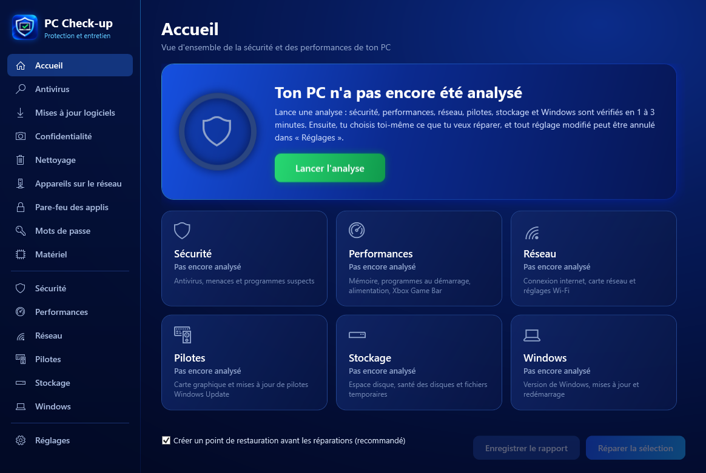
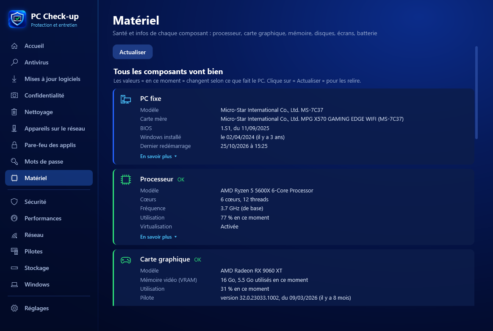
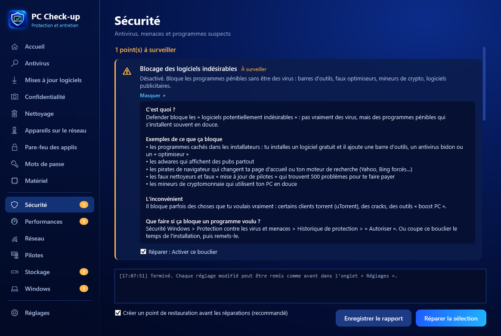

# PC Check-up

**Protection et entretien du PC, en un clic.**
Antivirus, performances, réseau, pilotes, stockage, matériel et Windows : tout est vérifié, expliqué simplement, et réparable sans rien casser.

&nbsp;

&nbsp;

[English](README.md) · **Français**

## ✨ Ce que fait PC Check-up

| | |
|---|---|
| 🛡️ **Sécurité** | Antivirus Microsoft Defender (rapide, complète, personnalisée, hors ligne), boucliers de protection, menaces détaillées par nom, programmes suspects |
| ⚡ **Performances** | Programmes au démarrage, mode d'alimentation, Xbox Game Bar, mémoire, temps de démarrage |
| 🌐 **Réseau** | Qualité de la connexion, pertes de paquets, réglages Wi-Fi anti-coupures, appareils connectés à la box |
| 🧩 **Pilotes** | Pilotes à jour via Windows Update, carte graphique |
| 💾 **Stockage** | Espace disque, santé des disques, nettoyage des fichiers inutiles |
| 🖥️ **Matériel** | Santé de chaque composant : âge et temps d'utilisation du PC, processeur, carte graphique, mémoire (XMP, double canal), usure et durée de vie des SSD, batterie, fréquence des écrans |
| 🧯 **Stabilité** | Écrans bleus, arrêts brutaux et logiciels qui plantent sur 30 jours, leur cause probable et quoi faire ; réparation des fichiers de Windows en un clic (SFC + DISM) ; périphériques en erreur |
| 🚀 **Test de débit** | Compteur de vitesse : téléchargement, envoi et ping, avec les 10 derniers résultats |
| 📄 **Rapport HTML** | Un beau rapport aux couleurs du logiciel (logo, état général, chaque résultat expliqué, stabilité, matériel) qui s'ouvre dans le navigateur |
| 🔎 **Recherche et menu rangé** | Groupes repliables dans le menu et barre de recherche (Ctrl+F) ; processeur, mémoire, températures de la carte graphique et des disques en direct dans « Matériel » |
| 🪟 **Windows** | Mises à jour, version, redémarrage en attente |
| 🔒 **Outils** | Mises à jour des logiciels, confidentialité (webcam, micro), pare-feu des applis, vérification des mots de passe |

## 🖥️ Santé du matériel

Chaque composant d'un coup d'œil, avec ce qui compte : usure et durée de vie restante des SSD, heures d'utilisation du PC, mémoire vidéo utilisée, mémoire en simple canal ou sans XMP, écran 144 Hz bloqué en 60 Hz, capacité restante de la batterie…

## 💡 Chaque problème expliqué

Sous chaque point, **« En savoir plus »** explique simplement : c'est quoi, pourquoi c'est important, des exemples et quoi faire.

## 🌍 Langues

Français, English, Español, Deutsch. PC Check-up prend automatiquement la langue de Windows, et elle se change dans **Réglages › Langue**.

## 🔄 Toujours annulable

- Rien n'est modifié sans ton accord : tu coches ce que tu veux réparer.
- Un point de restauration Windows est créé avant chaque réparation.
- Chaque réglage se remet comme avant en un clic, et un bouton remet **tout** comme avant PC Check-up.
- L'antivirus, le pare-feu, SmartScreen et l'UAC ne sont jamais désactivés.

## 📥 Installation

1. [Télécharge le zip](https://github.com/Tauwni/pc-checkup/releases/latest/download/PC-Checkup.zip), fais un clic droit dessus > **Extraire tout**.
2. Double-clique sur **PC-Checkup.exe** et accepte la demande d'autorisation de Windows.
3. Si Windows affiche « Windows a protégé votre ordinateur » : **Informations complémentaires** > **Exécuter quand même** (le logiciel n'est pas signé).

Le logiciel se met ensuite **à jour tout seul** : à chaque ouverture, il propose les nouvelles versions publiées ici, avec la liste des nouveautés.

## 🔐 Vie privée

PC Check-up n'envoie **aucune donnée** sur toi ou ton PC : pas de statistiques, pas de compte. Il contacte seulement GitHub pour vérifier les mises à jour, et la vérification des mots de passe n'envoie jamais le mot de passe (seulement un petit morceau de son empreinte chiffrée).
