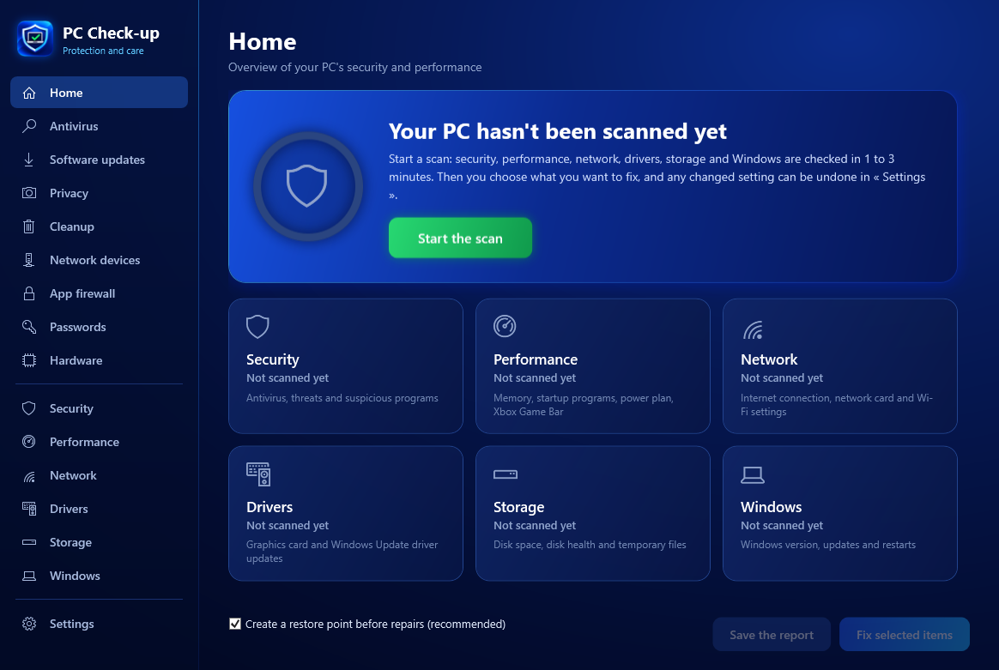
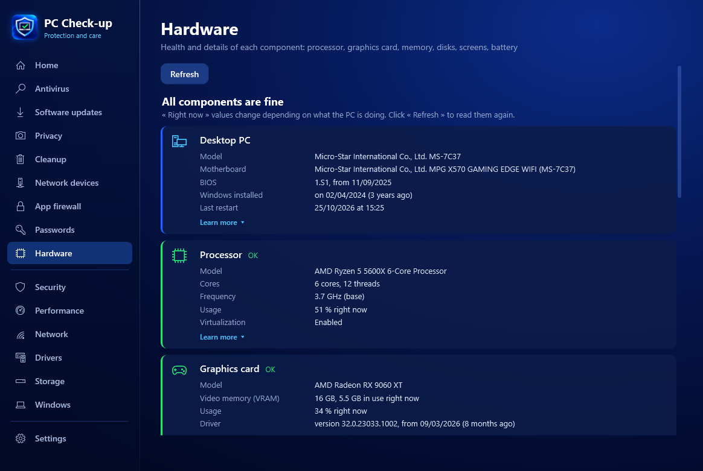

# PC Check-up

**PC protection and care, in one click.**
Antivirus, performance, network, drivers, storage, hardware and Windows: everything is checked, explained simply, and can be fixed without breaking anything.

&nbsp;

&nbsp;

**English** · [Français](README.fr.md)

## ✨ What PC Check-up does

| | |
|---|---|
| 🛡️ **Security** | Microsoft Defender antivirus (quick, full, custom, offline scans), protection shields, threats listed by name, suspicious programs |
| ⚡ **Performance** | Startup programs, power plan, Xbox Game Bar, memory, boot time |
| 🌐 **Network** | Connection quality, packet loss, anti-drop Wi-Fi settings, devices connected to your router |
| 🧩 **Drivers** | Up-to-date drivers through Windows Update, graphics card |
| 💾 **Storage** | Disk space, disk health, cleanup of useless files |
| 🖥️ **Hardware** | Health of each component: PC age and usage time, processor, graphics card, memory (XMP, dual channel), SSD wear and lifespan, battery, screen refresh rate |
| 🪟 **Windows** | Updates, version, pending restart |
| 🔒 **Tools** | Software updates, privacy (webcam, microphone), app firewall, password checker |

## 🖥️ Hardware health

Every component at a glance, with what matters: SSD wear and remaining lifespan, total hours the PC has been on, VRAM in use, memory running in single channel or without XMP, a 144 Hz screen stuck at 60 Hz, battery capacity left…

## 💡 Every problem explained

Under each item, **« Learn more »** explains it simply: what it is, why it matters, examples and what to do.

## 🌍 Languages

English, Français, Español, Deutsch. PC Check-up uses the Windows language automatically, and you can change it in **Settings › Language**.

## 🔄 Always reversible

- Nothing is changed without your consent: you tick what you want to fix.
- A Windows restore point is created before each repair.
- Each setting can be put back in one click, and one button puts **everything** back as it was before PC Check-up.
- The antivirus, firewall, SmartScreen and UAC are never turned off.

## 📥 Installation

1. [Download the zip](https://github.com/Tauwni/pc-checkup/releases/latest/download/PC-Checkup.zip), right-click it > **Extract All**.
2. Double-click **PC-Checkup.exe** and accept the Windows permission prompt.
3. If Windows shows « Windows protected your PC »: **More info** > **Run anyway** (the app isn't signed).

The app then **updates itself**: each time it opens, it offers the new versions published here, with the list of what's new.

## 🔐 Privacy

PC Check-up sends **no data** about you or your PC: no statistics, no account. It only contacts GitHub to check for updates, and the password checker never sends the password (only a small piece of its encrypted fingerprint).
